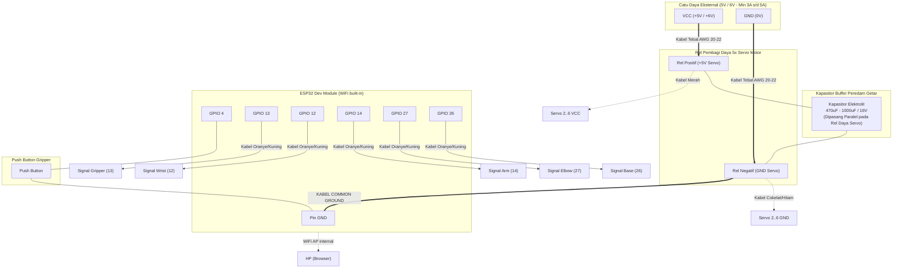
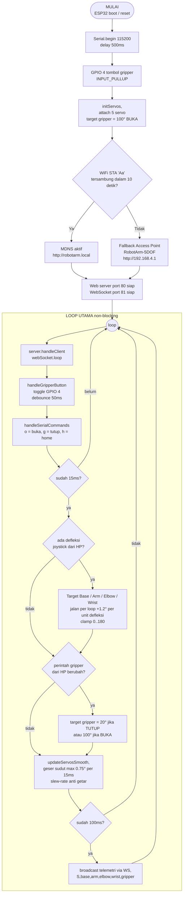
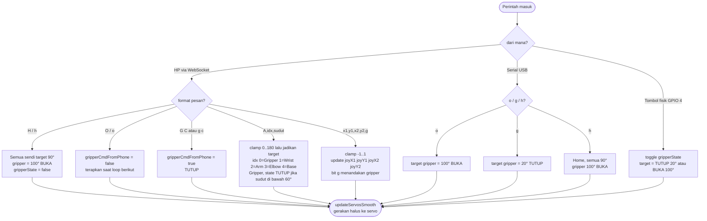
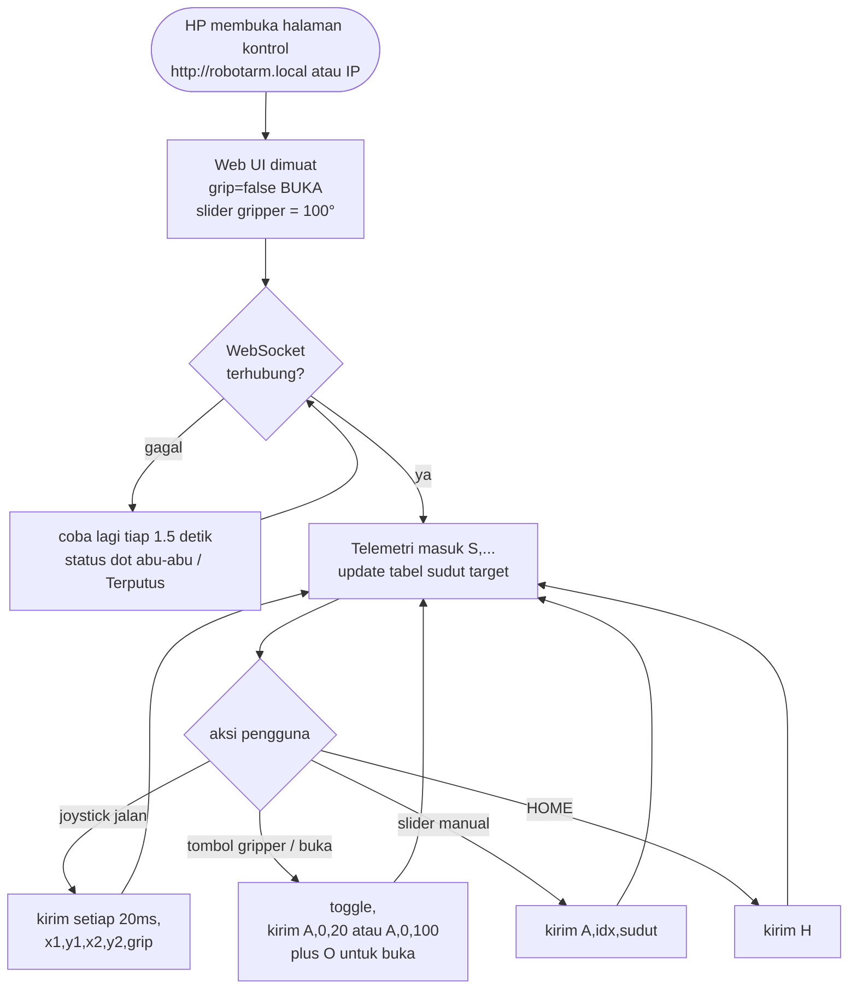

# Panduan Pengkabelan (Wiring Diagram) - Robot Arm 5-DOF ESP32

Dokumen ini memuat panduan pengkabelan elektrikal lengkap, skema diagram, dan langkah-langkah eliminasi getaran (*anti-twitching*) untuk proyek lengan robot 5 Degree of Freedom (5-DOF) berbasis ESP32 yang **dikendalikan murni dari handphone via WiFi**.

> **Perubahan utama:** Firmware (`src/main.cpp` / `arduino/robot_arm/robot_arm.ino`) dikendalikan **murni** dari HP (WiFi Access Point + halaman web + WebSocket). Modul joystick fisik **tidak dipakai sama sekali** oleh firmware saat ini — joystick di layar HP adalah virtual. Tidak ada kabel data tambahan untuk WiFi — modul WiFi sudah built-in di ESP32.

---

## 1. Tabel Pin Mapping ESP32

### A. Koneksi Servo Motor (5-DOF)
| Komponen Robot | Fungsi Gerak | Pin Sinyal ESP32 | Warna Kabel Servo (Signal) | Sumber Daya (VCC / GND) |
|---|---|---|---|---|
| **Servo 2** | Finger / Gripper | **GPIO 13** | Kuning / Putih / Oranye | PSU Eksternal 5V & Common GND |
| **Servo 3** | Wrist (Pergelangan) | **GPIO 12** | Kuning / Putih / Oranye | PSU Eksternal 5V & Common GND |
| **Servo 4** | Arm (Lengan Bawah) | **GPIO 14** | Kuning / Putih / Oranye | PSU Eksternal 5V & Common GND |
| **Servo 5** | Elbow (Siku) | **GPIO 27** | Kuning / Putih / Oranye | PSU Eksternal 5V & Common GND |
| **Servo 6** | Base (Rotasi Dasar) | **GPIO 26** | Kuning / Putih / Oranye | PSU Eksternal 5V & Common GND |

> **PERINGATAN KRUSIAL:** Kabel merah (+5V) dan kabel cokelat/hitam (GND) dari kelima servo **TIDAK BOLEH** dihubungkan ke pin 3.3V atau VIN ESP32! Hubungkan ke rel daya catu daya eksternal.

---

### B. Koneksi Tombol Push Button (Gripper Toggle)
| Komponen | Pin 1 | Pin 2 | Mode Firmware |
|---|---|---|---|
| **Push Button** | **GPIO 4** | **GND** (ESP32) | `INPUT_PULLUP` (Internal resistor aktif, tanpa perlu resistor eksternal) |

*Fungsi:* Menekan tombol ini akan membuka atau menutup gripper secara bergantian (*toggle*). Tombol ini tetap berfungsi walau dikendalikan dari HP.

---

### C. Modul Joystick Analog — TIDAK DIPAKAI oleh firmware
> Firmware saat ini **tidak membaca joystick fisik/ADC sama sekali** (tidak ada `#define USE_JOYSTICK` atau kode ADC di program). Seluruh gerakan (base, arm, elbow, wrist) dikendalikan oleh **virtual joystick dari HP** via WebSocket. Jika Anda tetap ingin memakai joystick analog fisik, Anda harus **memodifikasi firmware sendiri** (menambah kode pembacaan `analogRead()`). Pin ESP32 yang aman untuk ADC bersama WiFi dicadangkan di tabel berikut:

| Modul Joystick | Pin Joystick | Terhubung ke ESP32 | Keterangan |
|---|---|---|---|
| **Joystick 1** | **VCC** | **3.3V** ESP32 | Referensi tegangan linier ADC |
| | **GND** | **GND** ESP32 | Ground sinyal |
| | **VRX** | **GPIO 34** (ADC1_CH6) | Base (Kiri/Kanan) |
| | **VRY** | **GPIO 35** (ADC1_CH7) | Arm (Maju/Mundur) |
| **Joystick 2** | **VCC** | **3.3V** ESP32 | Referensi tegangan linier ADC |
| | **GND** | **GND** ESP32 | Ground sinyal |
| | **VRX** | **GPIO 32** (ADC1_CH4) | Elbow (Naik/Turun) |
| | **VRY** | **GPIO 33** (ADC1_CH5) | Wrist (Putar) |

> **CATATAN ADC:** Jika joystick dipakai bersama WiFi, gunakan pin ADC1 (GPIO 32–35). Hindari ADC2 (GPIO 0/2/4/12–15/25–27) karena konflik dengan WiFi.
>
> **PERHATIAN:** GPIO 13, 14, 27, 26 **tidak boleh** dipakai untuk joystick/sensor lain — semuanya sudah dipakai sinyal servo.

---

## 2. Koneksi & Penggunaan WiFi (Kontrol dari HP)

Firmware menjalankan **mode STA dulu** (ESP32 join WiFi rumah) — jika gagal, otomatis **fallback ke Access Point**. Bukan kabel — antena WiFi sudah built-in di ESP32.

| Item | Nilai |
|---|---|
| **WiFi rumah (dipakai dulu)** | SSID `ocillll`, password `plmoknijb` |
| **Alamat halaman (mode STA)** | `http://robotarm.local` — atau IP yang tampil di Serial Monitor |
| **SSID Access Point (fallback)** | `RobotArm-5DOF` |
| **Password AP** | `robotarm123` |
| **Halaman kontrol (mode AP)** | `http://192.168.4.1` |
| **Port WebSocket** | `81` (otomatis dipakai halaman) |
| **Max client (mode AP)** | 4 perangkat |

**Langkah penggunaan (mode STA / WiFi rumah):**
1. Nyalakan ESP32 (servo + PSU eksternal). Tunggu ±10 detik (coba connect ke `ocillll`).
2. HP: connect ke WiFi rumah yang **sama** (`ocillll`) — internet HP tetap hidup.
3. Buka browser → `http://robotarm.local` (atau IP yang tampil di Serial Monitor).
4. Halaman kontrol muncul: 2 virtual joystick, slider derajat, tombol gripper, Home, telemetri.
5. (Opsional) Serial Monitor 115200 untuk debug.

**Fallback (jika WiFi rumah mati/jaraknya jauh):** ESP32 otomatis jadi hotspot `RobotArm-5DOF` (pass `robotarm123`) → HP connect ke sana → buka `http://192.168.4.1`.

> **Catatan mode STA:** HP dan ESP32 harus satu jaringan. Kalau router memblokir mDNS, pakai IP langsung dari Serial Monitor. Di mode STA, radio ESP32 hidup `setSleep(false)` agar respons console/WebSocket tetap kencang (konsumsi daya sedikit naik, suhu chip masih normal 40–55 °C).

> **Catatan:** Di mode STA, ESP32 join WiFi rumah sehingga **internet HP tetap hidup** selama ikut kontrol. Internet hanya hilang di mode fallback AP (hotspot `RobotArm-5DOF`). WiFi rumah/AP bisa diganti lewat `#define WIFI_STA_SSID` / `WIFI_AP_SSID` di `src/main.cpp`.

> **Tips sinyal:** Jauhkan ESP32 dari benda metal/besi dan PSU switching yang bising agar jangkauan WiFi (~30 m) stabil. Antena PCB ESP32 (bagian zig-zag di ujung board) jangan ditutup.

---

## 2B. Parameter Firmware yang Berkaitan dengan Hardware

Nilai-nilai berikut dibaca langsung dari source code (`src/main.cpp`), sehingga penting dipahami saat memilih servo & PSU.

### A. Sinyal PWM Servo
| Parameter | Nilai | Keterangan |
|---|---|---|
| Frekuensi PWM | **50 Hz** (periode 20 ms) | Standar servo analog |
| Lebar pulsa | **500–2400 µs** | Dipakai oleh `servo.attach(pin, 500, 2400)` |
| Rentang sudut | **0°–180°** | `ANGLE_MIN` / `ANGLE_MAX` |
| Timer PWM yang dialokasi | Timer 0–3 (semuanya) | `ESP32PWM::allocateTimer(0..3)` oleh pustaka ESP32Servo |

### B. Posisi Sudut & Gerakan
| Parameter | Nilai | Keterangan |
|---|---|---|
| Posisi awal & Home | **90° semua sendi**, gripper **100°** (buka) | Perintah `h`/`H`/tombol 🏠 di HP |
| Gripper OPEN | **100°** | `GRIPPER_OPEN_ANGLE` |
| Gripper CLOSE | **20°** | `GRIPPER_CLOSE_ANGLE` |
| Interval update servo | **15 ms** | `SERVO_LOOP_INTERVAL_MS` |
| Langkah maksimum per update | **0.75°** | `MAX_STEP_DEG` (slew-rate interceptor, anti-getar) |
| Kecepatan virtual joystick | **1.2°/loop per unit defleksi (−1..1)** | `JOY_SPEED_FACTOR` |
| Deadzone joystick HP | **0.15** (throttle ke 0) | Di halaman kontrol web |

### C. Perintah Serial (USB, 115200 baud) — untuk debug
| Karakter | Aksi |
|---|---|
| `o` / `O` | Membuka gripper (100°) |
| `g` / `G` | Menutup gripper (20°) |
| `h` / `H` | Home: semua sendi ke 90°, gripper buka |

### D. Pustaka (diprovide oleh `platformio.ini`)
| Library | Versi | Fungsi |
|---|---|---|
| `madhephaestus/ESP32Servo` | ^3.0.6 | PWM servo pada ESP32 |
| `links2004/WebSockets` | ^2.4.1 | WebSocket port 81 (komunikasi HP ↔ ESP32) |

---

## 3. Skema Arsitektur Daya & Anti-Twitching

Penyebab utama servo bergetar liar (*twitching / jitter*) adalah:
1. **Voltage Sag**: Arus start 5 servo bersamaan mencapai 3A - 5A, menyebabkan drop tegangan jika power supply kurang kuat.
2. **Inductive Back-EMF**: Motor induktif servo memantulkan noise elektromagnetik kembali ke jalur suplai.
3. **Floating Ground**: Ketiadaan sambungan ground bersama (*common ground*) antara ESP32 dan servo menyebabkan pulsa PWM tidak memiliki titik nol referensi.



---

## 4. Tata Letak Pemasangan Kapasitor Buffer

Gunakan kapasitor elektrolit berkapasitas **470µF hingga 1000µF** dengan rating voltase **10V atau 16V**.

```
          Rel Daya Eksternal +5V  ------------------------o-- (+ Kaki Panjang)
                                                             |
                                                       [ KAPASITOR ]
                                                       [ 1000uF 16V]
                                                             |
          Rel Daya Eksternal GND  ------------------------o-- (- Kaki Pendek / Strip Garis)
                                                             |
          ESP32 Pin GND           ---------------------------o  (COMMON GROUND)
```

> **Aturan Pemasangan:**
> 1. Pasang kapasitor sedekat mungkin dengan pin input daya servo (misalnya pada breadboard power rail atau terminal blok servo).
> 2. **Perhatikan polaritas!** Kaki dengan tanda minus strip putih/abu-abu pada bodi kapasitor harus dipasang ke jalur **GND**. Pemasangan terbalik dapat merusak kapasitor.

---

## 5. Langkah Pengkabelan Langkah demi Langkah

### Langkah 1: Siapkan Jalur Common Ground
1. Ambil kabel jumper, hubungkan pin **GND pada ESP32** ke jalur **GND pada Catu Daya Eksternal**.
2. *Peringatan:* Langkah ini tidak boleh dilewati, karena sinyal PWM dari pin ESP32 memerlukan jalur balik (*return path*) ground yang sama agar dapat dibaca oleh rangkaian kontrol internal servo.

### Langkah 2: Hubungkan Catu Daya Servo
1. Hubungkan jalur **+5V dari PSU Eksternal** ke rel positif servo (kabel merah).
2. Hubungkan jalur **GND dari PSU Eksternal** ke rel negatif servo (kabel cokelat/hitam).
3. Tancapkan **Kapasitor 1000µF** melintangi rel positif dan negatif tersebut.

### Langkah 3: Hubungkan Pin Sinyal Servo ke ESP32
1. Servo Gripper (Kabel Kuning) -> Pin **GPIO 13**
2. Servo Wrist (Kabel Kuning)   -> Pin **GPIO 12**
3. Servo Arm (Kabel Kuning)     -> Pin **GPIO 14**
4. Servo Elbow (Kabel Kuning)   -> Pin **GPIO 27**
5. Servo Base (Kabel Kuning)    -> Pin **GPIO 26**

### Langkah 4: Hubungkan Tombol Gripper
1. Satu kaki tombol -> Pin **GPIO 4**
2. Kaki tombol satunya -> Pin **GND ESP32**

### Langkah 5 (Tidak diperlukan): Modul Joystick Fisik
Firmware **tidak memakai joystick analog sama sekali** — semua kontrol lewat virtual joystick di HP. Joystick fisik hanya perlu dihubungkan jika Anda memodifikasi firmware sendiri; pin cadangan yang aman lihat bagian **1.C** di atas.

### Langkah 6: Nyalakan & Uji WiFi
1. Nyalakan PSU eksternal servo terlebih dahulu, baru ESP32.
2. Di HP: connect ke WiFi `RobotArm-5DOF` (pass `robotarm123`).
3. Buka browser → `http://192.168.4.1` → uji gerakan & gripper.
4. (Opsional) Serial Monitor 115200 untuk debug.

---

## 6. Checklist Verifikasi & Troubleshooting

| Gejala Masalah | Penyebab Umum | Solusi Cepat |
|---|---|---|
| **Servo bergetar cepat tanpa henti (*jittering*)** | - Belum ada Common Ground.<br>- Arus daya tidak stabil/drop. | - Pastikan GND PSU eksternal tersambung ke GND ESP32.<br>- Pasang kapasitor 1000µF 16V pada rel daya servo. |
| **ESP32 me-restart sendiri saat servo bergerak** | *Brown-out reset* karena servo ditenagai dari ESP32. | Pisahkan total daya servo ke PSU eksternal 5V minimal 3A–5A. |
| **HP tidak bisa connect ke hotspot** | SSID salah / password salah / terlalu jauh. | Pastikan SSID `RobotArm-5DOF`, password `robotarm123`, jarak < 10 m. Cek Serial Monitor untuk status AP. |
| **Halaman kontrol tidak muncul** | IP salah / belum connect ke hotspot. | Pastikan HP sudah connect ke hotspot ESP32, lalu buka `http://192.168.4.1` (bukan https). |
| **Status "Terputus" di halaman** | WebSocket port 81 diblok / koneksi lemah. | Reload halaman; pastikan hanya 1 tab; cek jarak & interferensi WiFi. |
| **Servo tidak bergerak dari HP** | Defleksi joystick < deadzone 0.15. | Dorong joystick lebih jauh; atau turunkan threshold 0.15 di halaman kontrol. |
| **Gerakan servo terbalik arah** | Orientasi mekanik servo terbalik. | Tukar tanda penambahan kecepatan di loop utama (`joyX1 * JOY_SPEED_FACTOR`) dari `+` menjadi `-`. |
| **Sinyal WiFi lemah / sering putus** | ESP32 terlalu dekat metal/PSU bising. | Jauhkan dari metal & PSU switching; jangan tutup antena PCB. |
| **Servo bergetar saat HP diam** | Defleksi residual / noise. | Naikkan deadzone threshold (0.15 → 0.2) di halaman kontrol; pastikan jari benar-benar dilepas. |

---

## 7. Flowchart Alur Program (Firmware)

Berikut alur kerja firmware (`src/main.cpp`) dalam bentuk diagram. Dibagi menjadi tiga: **alur utama** (boot & loop), **alur perintah masuk** (WebSocket / Serial / tombol fisik), dan **alur sisi HP** (halaman kontrol web).

### 7.A Flowchart Utama — Boot & Loop Firmware



### 7.B Alur Perintah Masuk (WebSocket / Serial / Tombol Fisik)



### 7.C Alur Sisi HP (Halaman Kontrol HTML)



> **Catatan:** Sesuai kode di `initServos()`, saat boot gripper mulai bergerak menuju **100° (BUKA)** secara halus (kira-kira 300 ms, karena slew-rate 0.75°/15ms), sehingga posisi firmware dan tampilan halaman HP selalu konsisten.